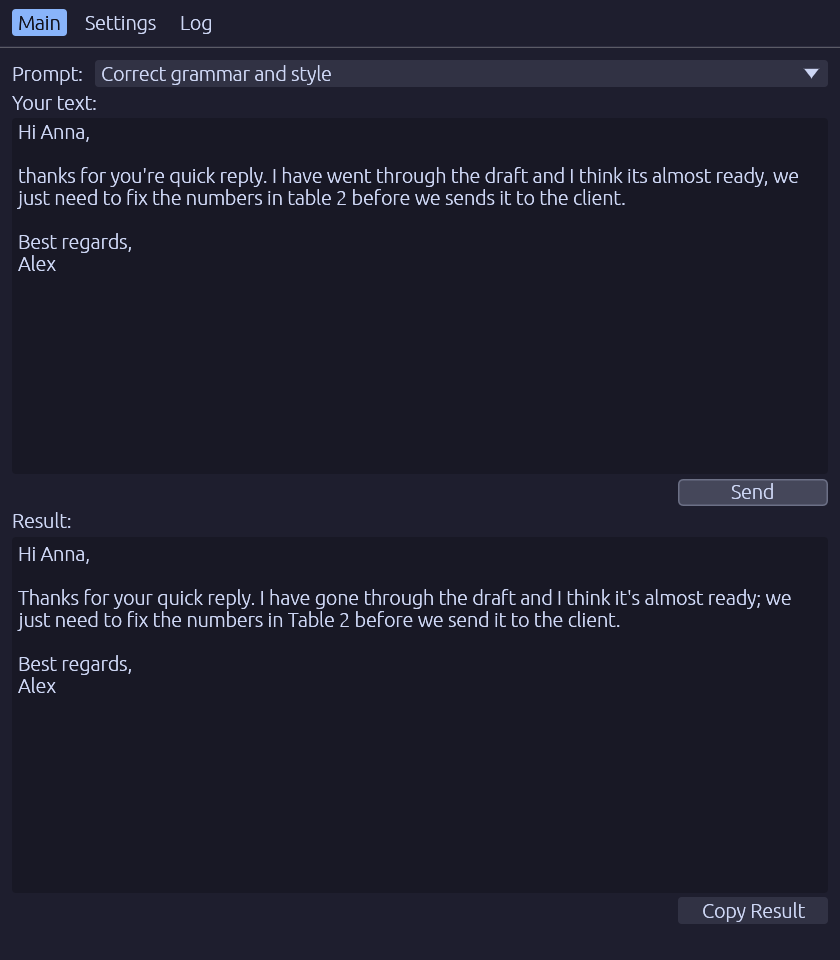

# AI Assistant

A desktop app for running your text through any AI model, using your own reusable prompts.

Define a prompt once (a name, a system instruction and an AI model) and reuse it any time: pick it
from the list, paste in your text, press **Send** and read the result. Build a small library of
prompts for the tasks you repeat often, such as fixing grammar, rewriting a paragraph, translating,
summarizing or adjusting tone, each backed by whichever model fits it best (including free ones),
all through your own [OpenRouter](https://openrouter.ai/) API key.

<p align="center"></p>

A Rust port of the Python/PySide6 app AiAssistantLinux, built with egui. It runs on Windows, macOS,
Linux and FreeBSD, and in the browser.

## Usage

1. Start the app: `cargo run -p aiassist` (or an installed package).
2. On the **Settings** tab, paste your OpenRouter API key and press **Save Settings**. **Balance**
   shows the account's credits.
3. Add prompts (Settings → **Add**): a title, the system prompt and a model chosen from the
   OpenRouter catalogue.
4. On the **Main** tab, pick a prompt, enter your text and press **Send** (or Ctrl+Enter). The
   answer appears under **Result**; **Copy Result** puts it on the clipboard.
5. The **Log** tab shows what happened.

## Browser version

`aiassist-web-<version>.zip` from a release is a static website. Browsers do not run WebAssembly
from a page opened as a local file, so serve the unpacked folder over HTTP:

```sh
python3 -m http.server 8000 --bind 127.0.0.1
```

and open <http://127.0.0.1:8000>, or upload it to any static host. `README-web.md` in the archive
has the details.

## Where settings are kept

| Platform | Settings (`settings.json`) | API key |
|---|---|---|
| Linux, FreeBSD | `~/.config/aiassistant/` (`$XDG_CONFIG_HOME`) | Secret Service (KWallet, GNOME Keyring) |
| macOS | `~/Library/Application Support/AI Assistant/` | Keychain |
| Windows | `%APPDATA%\AI Assistant\` | Credential Manager |
| Browser | the site's local storage | the site's local storage |

On Linux the file and the keyring entry are the Python AiAssistantLinux app's, so both apps share
prompts and key. Without a keyring the key goes to `.api_key` beside the settings, readable only by
you. A `portable.txt` beside the executable keeps everything in `aiassist-data/` next to it.

## Build and test

```sh
cargo run -p aiassist                          # desktop app
cargo xtask ci                                 # fmt, clippy, tests, wasm32 check, cargo-deny
cd apps/aiassist-web && trunk serve            # web version on http://127.0.0.1:8080
cargo test -p aiassist-ui --test live -- --ignored --nocapture   # live OpenRouter check (free model)
cargo test -p aiassist-ui --test screenshot -- --ignored         # re-render docs/screenshot.png (needs a GPU)
```

Linux needs the windowing headers first, e.g. on Debian/Ubuntu:

```sh
sudo apt-get install libxkbcommon-dev libwayland-dev libx11-dev libxrandr-dev libxi-dev libgl1-mesa-dev libgtk-3-dev
```

`AIASSIST_RENDERER=gl` starts with OpenGL instead of wgpu; `RUST_LOG` sets the log level on stderr.

## Layout

| Path | What |
|---|---|
| `crates/core` | settings model, OpenRouter requests and responses; no GUI, no I/O, builds for wasm32 |
| `crates/ui` | the egui app, dialogs, themes, and the desktop/web storage and HTTP |
| `apps/aiassist` | desktop binary (wgpu, OpenGL fallback) |
| `apps/aiassist-web` | browser binary (trunk) |
| `xtask` | `cargo xtask version`, `ci`, `wasm`, `deny` |
| `packaging/` | installers for every platform |

Made from the [RustGuiSpec](https://github.com/cpCr4zy/RustGuiSpec) template; `docs/` holds its
specification and CI/CD description.

## Releasing

`cargo xtask version set X.Y.Z`, merge to `main`, fast-forward `release` and push: the Release
workflow drafts a GitHub Release with every installer.

## Licence

MIT OR Apache-2.0.
